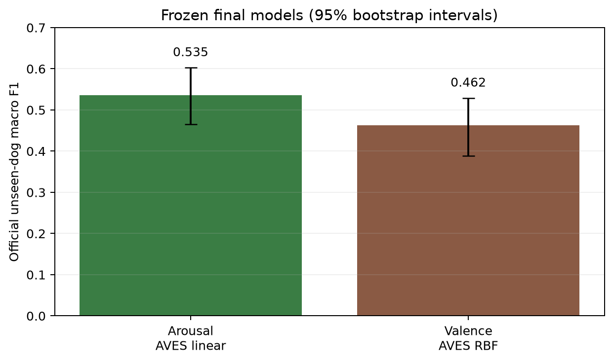

# Final accuracy-oriented model selection

This final iteration tested whether a more stable development protocol could
improve valence without repeatedly searching the official test labels. Four
predeclared candidates were compared by five-fold stratified development CV;
the AVES layer-3 RBF SVM had the highest mean macro F1 and the lowest fold-to-
fold variation.

| Valence candidate | 5-fold mean macro F1 | SD | OOF macro F1 | OOF accuracy |
|---|---:|---:|---:|---:|
| Rich acoustic ExtraTrees | 0.428 | 0.030 | 0.429 | 0.451 |
| AVES L3 linear SVM | 0.422 | 0.016 | 0.423 | 0.433 |
| AVES + acoustic ExtraTrees | 0.431 | 0.030 | 0.434 | 0.479 |
| **AVES L3 RBF SVM** | **0.437** | **0.009** | **0.439** | 0.454 |

The frozen RBF candidate was then checked once on the official unseen-dog set.
It reached **0.465 accuracy and 0.462 macro F1**, below the earlier richer-
acoustic ExtraTrees result of **0.480 accuracy and 0.472 macro F1**. This is a
useful negative result: more stable clip-level development performance did not
transfer into a higher unseen-dog point estimate.

The runnable presentation model keeps the strongest already-observed target-
specific point estimates: AVES-bio for arousal and richer-acoustic ExtraTrees
for valence. Because several official results have now been inspected, those
numbers are described as exploratory point estimates, not a pristine final test.



## Reproduction

```bash
python code/final_selection.py \
  --manifest results/local/audit/manifest.json \
  --acoustic-cache results/local/week3_features.npz \
  --aves-cache results/local/aves_base_bio \
  --output results/final_selection
```

Exact folds, candidate scores, selected configurations, official metrics, and
bootstrap intervals are stored in `run.json` and `summary.csv`.
