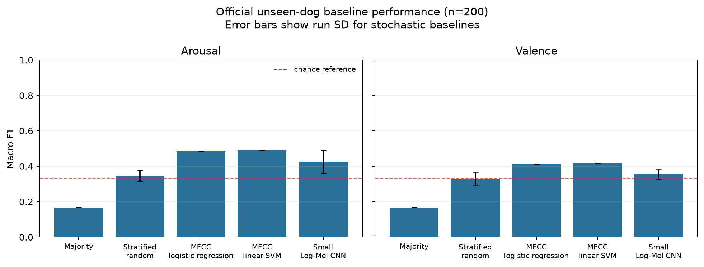

# Week 3 honest baselines

This directory is generated by `code/baselines.py`. The fixed validation
partition is stratified by breed plus the joint arousal/valence label. It
may contain the same dogs or recording sources on both sides because public
dog IDs are unavailable. Only the official test is verified dog-disjoint.

## Pooled macro F1

| Model | Arousal validation | Arousal official | Valence validation | Valence official |
|---|---:|---:|---:|---:|
| Majority | 0.178 | 0.167 | 0.195 | 0.167 |
| Stratified random | 0.332 ± 0.035 | 0.345 ± 0.030 | 0.332 ± 0.025 | 0.329 ± 0.039 |
| MFCC logistic regression | 0.481 | 0.485 | 0.375 | 0.410 |
| MFCC linear SVM | 0.485 | 0.490 | 0.416 | 0.419 |
| Small Log-Mel CNN | 0.484 ± 0.012 | 0.424 ± 0.064 | 0.415 ± 0.004 | 0.354 ± 0.026 |

The classical-model `C` values were selected separately for each target on
validation, then the models were refit on all 1,195 eligible training clips
before official testing. The CNN selected an epoch on validation for each of
three seeds and was retrained on all eligible training clips for that many epochs.
Stratified-random values are means across 20 fixed seeds.

## Reproduction

```bash
python code/audio_pipeline.py audit --root data/raw/EmotionalCanines --output results/local/audit
python code/baselines.py --manifest results/local/audit/manifest.json --output results/week3_baselines --cache results/local/week3_features.npz
```

## Boundaries

- Five released training rows are excluded under the predeclared duplicate policy.
- No official-test label is used for model or epoch selection.
- The MFCC baseline is not an eGeMAPS implementation.
- The CNN uses per-clip normalized, center-cropped/padded four-second Log-Mel inputs.
- This is a Week 3 baseline, not evidence that the model reads private emotion or is ready for deployment.
- Test-set duplicate sensitivity, confidence intervals, and cross-breed transfer remain Week 4 work.

## Selection record

Classical choices: `{"MFCC linear SVM/arousal": {"selected_C": 0.01, "trials": [{"C": 0.01, "validation_macro_f1": 0.48454306254791063}, {"C": 0.1, "validation_macro_f1": 0.4781103763004215}, {"C": 1.0, "validation_macro_f1": 0.47815811624187293}, {"C": 10.0, "validation_macro_f1": 0.47815811624187293}]}, "MFCC linear SVM/valence": {"selected_C": 0.01, "trials": [{"C": 0.01, "validation_macro_f1": 0.4156713797836009}, {"C": 0.1, "validation_macro_f1": 0.3913354815610455}, {"C": 1.0, "validation_macro_f1": 0.39452771475682175}, {"C": 10.0, "validation_macro_f1": 0.39452771475682175}]}, "MFCC logistic regression/arousal": {"selected_C": 0.01, "trials": [{"C": 0.01, "validation_macro_f1": 0.4810615445901334}, {"C": 0.1, "validation_macro_f1": 0.4737952382418052}, {"C": 1.0, "validation_macro_f1": 0.47033242353426213}, {"C": 10.0, "validation_macro_f1": 0.47033242353426213}]}, "MFCC logistic regression/valence": {"selected_C": 1.0, "trials": [{"C": 0.01, "validation_macro_f1": 0.3657460317460317}, {"C": 0.1, "validation_macro_f1": 0.3668325150746317}, {"C": 1.0, "validation_macro_f1": 0.37548100048100047}, {"C": 10.0, "validation_macro_f1": 0.37548100048100047}]}}`

CNN best epochs: `[{"seed": 3108, "selected_epoch": 13}, {"seed": 3109, "selected_epoch": 5}, {"seed": 3110, "selected_epoch": 5}]`


