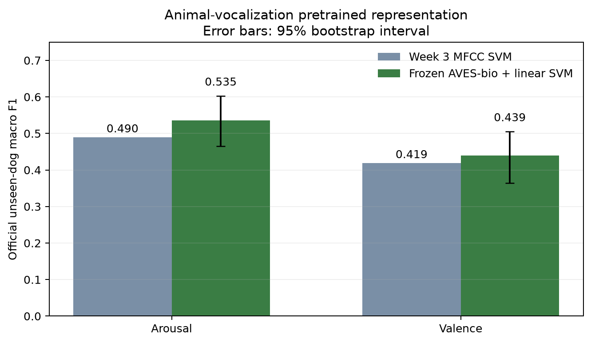

# Frozen AVES-bio representation experiment

AVES-bio is a HuBERT-style encoder pretrained on 360 hours including animal
vocalizations. Official TorchAudio weights are frozen, and embeddings are
computed one clip at a time to avoid the authors' documented padding effect.
Only a class-balanced linear SVM is fitted on EmotionalCanines.

## Official unseen-dog result

| Target | Selected configuration | Validation F1 | Official F1 (95% CI) | Week 3 F1 | Difference (95% CI) |
|---|---|---:|---:|---:|---:|
| Arousal | L6, mean_std, breed=True, C=0.0001 | 0.586 | 0.535 (0.465, 0.602) | 0.490 | +0.046 (-0.025, +0.113) |
| Valence | L3, mean_std, breed=True, C=0.001 | 0.463 | 0.439 (0.364, 0.505) | 0.419 | +0.020 (-0.062, +0.100) |



## Reproduction

Download the official MIT-licensed AVES-bio TorchAudio model and config:

```bash
curl -L --output results/local/models/aves/aves-base-bio.torchaudio.pt https://storage.googleapis.com/esp-public-files/ported_aves/aves-base-bio.torchaudio.pt
curl -L --output results/local/models/aves/aves-base-bio.torchaudio.model_config.json https://storage.googleapis.com/esp-public-files/ported_aves/aves-base-bio.torchaudio.model_config.json
python code/bioacoustic_baselines.py \
  --manifest results/local/audit/manifest.json \
  --model results/local/models/aves/aves-base-bio.torchaudio.pt \
  --config results/local/models/aves/aves-base-bio.torchaudio.model_config.json \
  --cache results/local/aves_base_bio \
  --output results/week6_aves_bio
```

## Boundaries

- Audio is center-cropped to at most four seconds; the encoder is not fine-tuned.
- AVES is general bioacoustic pretraining, not canine-affect supervision.
- Public dog/source IDs remain unavailable for grouped development validation.
- Official labels are used only for final reporting, not configuration selection.
- These behavior/context labels do not reveal a dog's private emotional state.
