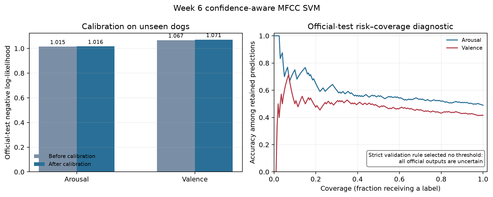

# Week 6 real-model confidence experiment

One frozen MFCC linear SVM per target was trained on the 956 Week 3 fit
clips. The 239 development-validation clips were divided into 119
temperature-calibration and 120 threshold-selection clips. The official
200-clip unseen-dog test was used only after both policies were frozen.

## Official unseen-dog result

| Target | Temperature | Threshold | NLL before → after | Coverage | Retained accuracy | Uncertain |
|---|---:|---:|---:|---:|---:|---:|
| Arousal | 1.155 | none | 1.015 → 1.016 | 0.000 | n/a | 200/200 |
| Valence | 2.394 | none | 1.067 → 1.071 | 0.000 | n/a | 200/200 |

The threshold rule maximizes selection-set coverage subject to empirical error ≤ 20%
and at least 20 retained validation examples. This is not a test-risk guarantee.



## Reproduction

```bash
python code/confidence_experiment.py \
  --manifest results/local/audit/manifest.json \
  --cache results/local/week3_features.npz \
  --local-output results/local/week6_confidence \
  --output results/week6_confidence
```

## Interpretation boundaries

- `LinearSVC.decision_function` values are treated as three class scores; they are not native probabilities.
- Temperature and threshold selection use disjoint clips and the exact same frozen model.
- The Week 3 value `C=0.01` is frozen rather than retuned in this experiment.
- The development partition is clip-level because public dog/source IDs are unavailable.
- `reliable` means the score passed an empirical validation rule, not that the prediction is guaranteed correct.
- The official labels are used only for final reporting, never for temperature or threshold selection.
