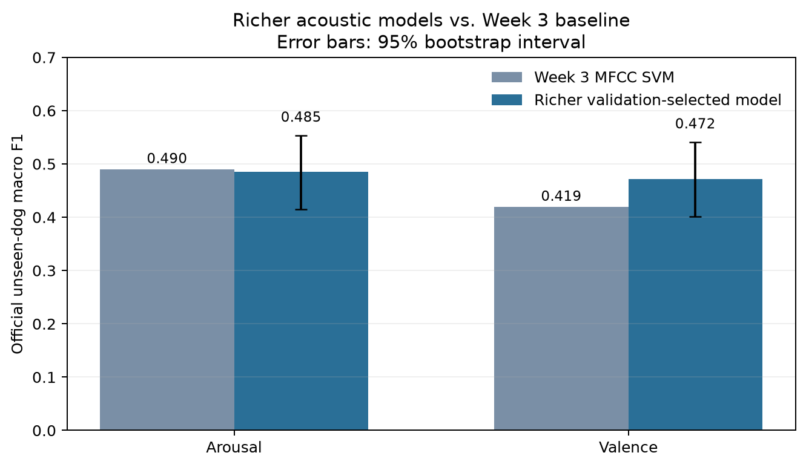

# Richer acoustic baseline iteration

Candidate models were selected only on the fixed Week 3 validation split,
then refit on all 1,195 eligible training clips and evaluated once on the
200 official unseen-dog clips. This is an exploratory improvement, not a
claim of precise emotion recognition.

## Official unseen-dog results

| Target | Selected model | Validation F1 | Official F1 (95% CI) | Week 3 F1 | Difference (95% CI) |
|---|---|---:|---:|---:|---:|
| Arousal | Linear SVM | 0.550 | 0.485 (0.414, 0.553) | 0.490 | -0.004 (-0.072, +0.066) |
| Valence | ExtraTrees | 0.459 | 0.472 (0.402, 0.541) | 0.419 | +0.053 (-0.033, +0.137) |



## What changed

The representation concatenates the Week 3 MFCC summary with Log-Mel
distribution statistics, temporal deltas, four-region temporal pooling,
and the known Husky/Shiba breed indicator. A small validation-only grid
compares strongly regularized linear SVMs and ExtraTrees models.

## Boundaries

- The official test was not used to choose the feature set or hyperparameters.
- Breed is available metadata here; the two-value encoding cannot represent unseen breeds.
- The development split is clip-level because public dog/source IDs are unavailable.
- Bootstrap intervals describe sampling uncertainty on these 200 clips, not all dogs or breeds.
- These are context/behavior annotations, not direct measurements of private emotion.
- A higher point estimate is not automatically a statistically clear improvement; inspect the paired difference interval.

## Reproduction

```bash
python code/improved_baselines.py \
  --manifest results/local/audit/manifest.json \
  --cache results/local/week3_features.npz \
  --output results/week6_improved_models
```
