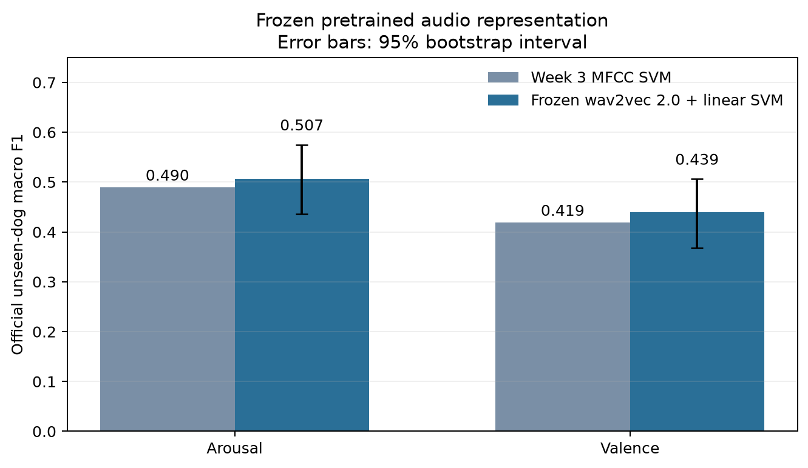

# Frozen wav2vec 2.0 representation experiment

A 94M-parameter wav2vec 2.0 Base encoder pretrained on LibriSpeech is
kept frozen. Per-layer valid-frame means and standard deviations are
cached locally; only a class-balanced linear SVM is trained. Layer, pooling,
breed metadata, and regularization are selected on development validation.

## Official unseen-dog result

| Target | Selected configuration | Validation F1 | Official F1 (95% CI) | Week 3 F1 | Difference (95% CI) |
|---|---|---:|---:|---:|---:|
| Arousal | L3, mean_std, breed=False, C=0.0001 | 0.546 | 0.507 (0.435, 0.575) | 0.490 | +0.017 (-0.057, +0.093) |
| Valence | L12, mean, breed=False, C=0.01 | 0.446 | 0.439 (0.367, 0.506) | 0.419 | +0.020 (-0.066, +0.109) |



## Reproduction

The first run downloads about 360 MB of weights and writes roughly 103 MB
of resumable embedding cache under `results/local/`; neither is committed.

```bash
python code/pretrained_baselines.py \
  --manifest results/local/audit/manifest.json \
  --cache results/local/wav2vec2_base \
  --output results/week6_pretrained
```

## Boundaries

- The encoder is pretrained on human speech, not canine affect.
- Audio is center-cropped to at most four seconds; no fine-tuning is performed.
- Public dog/source IDs are unavailable for dog-grouped development validation.
- This is the planned pretrained-model-family confirmation, not permission to tune repeatedly on official labels.
- The labels describe observed behavior/context, not a dog's private emotional state.
